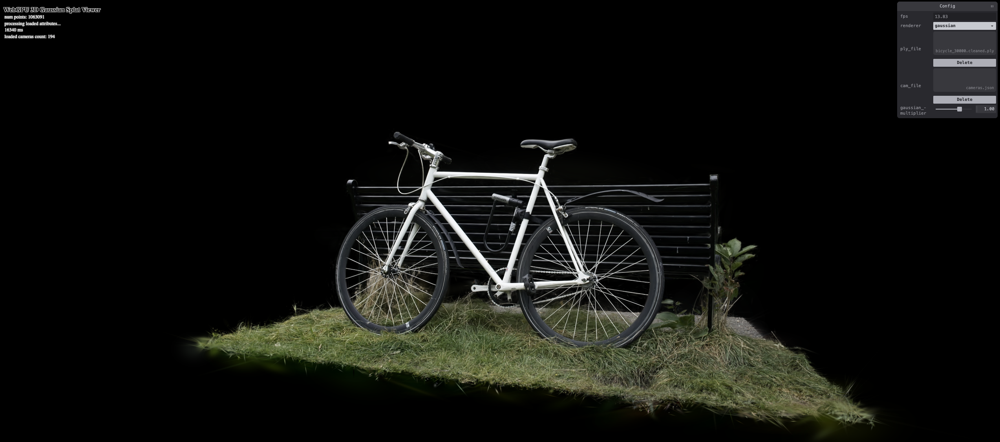
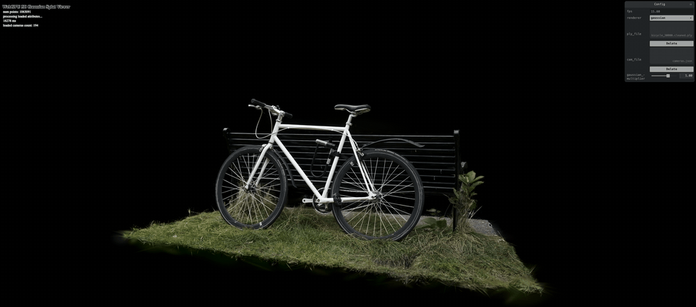
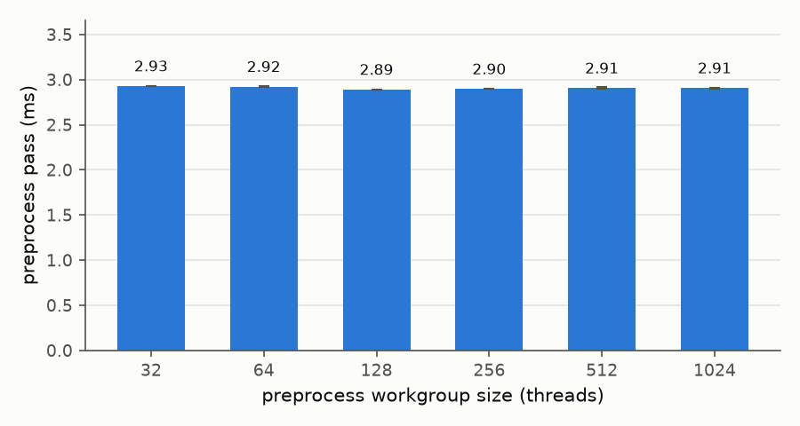
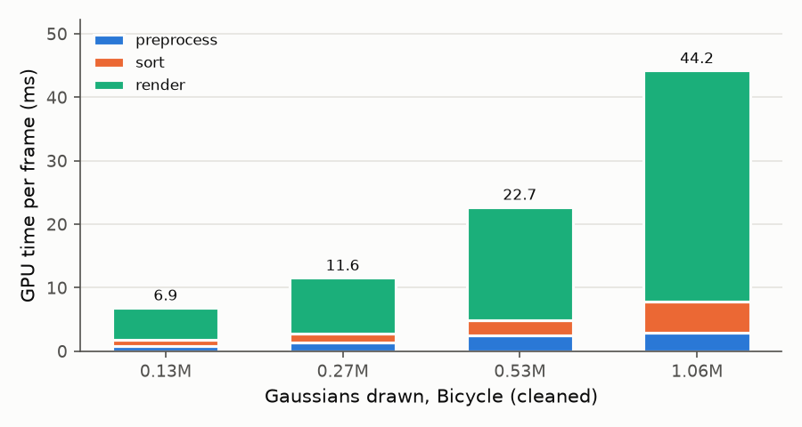

# Project5-WebGPU-Gaussian-Splat-Viewer

**University of Pennsylvania, CIS 565: GPU Programming and Architecture, Project 5**

* Josh Kim
  * [LinkedIn](https://www.linkedin.com/in/euikwang-kim), [personal website](https://euikwang.com)
* Tested on: **Google Chrome** on
  macOS 26.5.1, Apple M1 (8-core GPU) 16 GB (MacBook Pro 13-inch, 2020)

### Live Demo

Click the image to open the live demo. It shows nothing until you load a scene. Pick a PLY file [here](https://drive.google.com/drive/folders/1Fz0QhyDU12JTsl2e7umGi5iy_V9drrIW) and its cameras.json from the course's scene files, then switch the renderer to gaussian.

### Demo GIF

### Overview

This is a 3D Gaussian splat viewer written in WebGPU. It loads a trained scene from a PLY file and draws each Gaussian as a soft colored ellipse. Every frame runs three passes. A compute pass projects the Gaussians onto the screen. A radix sort orders them by depth. A render pass draws them back to front with alpha blending.

### Features

- Point cloud renderer with the MVP transform.
- Preprocess compute pass
  - View frustum culling with a box 1.2 times the size of the screen.
  - 3D covariance from each Gaussian's rotation and scale. The gaussian multiplier slider scales it.
  - 2D covariance, conic, radius and quad size in NDC.
  - Color from spherical harmonics and opacity from a sigmoid.
  - Depth keys and indices for the sort, plus the number of sort workgroups to launch.
- Indirect draw. The visible count from the preprocess pass becomes the instance count.
- Render pass that draws one quad per Gaussian. The conic gives each pixel its falloff and the splats blend with premultiplied alpha.

### Radix Sort Fix for Apple GPUs

The provided radix sort froze my Mac. In its scatter step each workgroup waits in a loop for the workgroup before it. The M1 does not keep that earlier workgroup running. One frame took 57 seconds and macOS restarted the window server. I added a small kernel that runs before each scatter pass and writes every block's digit counts first. The scatter never has to wait now. I also made the sorted index buffer as long as the padded key buffer. Before that a few indices were lost when every Gaussian was visible. I checked the fix by sorting random keys and comparing the result.

### Performance Analysis
I timed each pass with GPU timestamp queries. I also timed each frame from its start until the GPU finished. I did not use the FPS counter because the display caps it at 60. Each number is the mean of three blocks of 60 frames. Lower is better. I used three scenes: Bonsai (272,956 Gaussians), Bicycle (cleaned) (1,063,091) and Bicycle (full) (6,131,954). Unless I say otherwise, the camera is at the first view in the scene's cameras.json, which is where the app starts.

#### Compare your results from point-cloud and gaussian renderer, what are the differences?

| Scene | Gaussians | Visible | Point cloud (ms) | Gaussian (ms) |
|---|---|---|---|---|
| Bonsai | 272,956 | 112,048 | 1.2 | 7.9 |
| Bicycle (cleaned) | 1,063,091 | 1,063,091 | 6.7 | 46.8 |
| Bicycle (full) | 6,131,954 | 2,418,177 | 19.0 | 101.4 |

The point cloud draws one pixel per Gaussian. The Gaussian renderer runs a preprocess pass and a sort and then draws a whole quad per Gaussian. Rendering takes most of the time. On Bicycle (cleaned) it is 36.4 ms of the 46.8 ms. The quads overlap and every pixel blends many of them. Moving the camera toward the bike shows this best. Fewer Gaussians are on screen there (611,309), but a frame takes 100.2 ms because the splats near the camera cover much more of the screen.

#### For gaussian renderer, how does changing the workgroup-size affect performance? Why do you think this is?

I changed the preprocess workgroup size from 32 to 1024 on Bicycle (cleaned). The preprocess pass stayed between 2.89 and 2.93 ms, which is within noise. I think the size does not matter because the pass is limited by memory. Its threads share no memory and never wait at a barrier. The GPU runs threads in groups of 32, and a million threads keep it full at every size.

#### Does view-frustum culling give performance improvement? Why do you think this is?

| View | Culling | Visible | Preprocess | Sort | Render | Frame (ms) |
|---|---|---|---|---|---|---|
| Bonsai | on | 112,048 | 0.53 | 0.63 | 5.34 | 7.87 |
| Bonsai | off | 272,956 | 0.79 | 1.32 | 6.50 | 10.37 |
| Bicycle (cleaned) | on | 1,063,091 | 2.95 | 4.88 | 36.39 | 46.77 |
| Bicycle (cleaned) | off | 1,063,091 | 2.93 | 4.82 | 34.76 | 44.95 |
| Bicycle (cleaned), camera moved toward the bike | on | 611,309 | 2.34 | 2.71 | 92.66 | 100.20 |
| Bicycle (cleaned), camera moved toward the bike | off | 1,055,053 | 2.93 | 4.79 | 97.50 | 107.80 |

Culling helps when much of the scene is off screen. Bonsai's starting view looks down at the table, so 59% of its Gaussians are off screen. Culling removes them and saves 2.5 ms (24%). The sort gets fewer than half the keys. Preprocess gets faster too because culled threads stop before the covariance and color work. Render saves the smallest share because off-screen quads produce no pixels anyway. The starting view of Bicycle (cleaned) shows the whole bike. Nothing gets culled and there is no difference beyond noise. So I also moved the camera toward the bike until 42% of the Gaussians were off screen. There culling saves 7.6 ms (7%), since rendering the large on-screen splats dominates. With culling off I still drop Gaussians behind the camera.

#### Does number of gaussians affect performance? Why do you think this is?

To change only the count I kept every 2nd, 4th or 8th Gaussian of Bicycle (cleaned) and used the same view. From 0.27M Gaussians up, the frame time nearly doubles each time the count doubles. Render grows the most because more splats overlap on the same pixels. The sort grows with the number of keys. Preprocess grows less because it still starts one thread per Gaussian in the file. The three scenes in the first table agree. The frame time grows with the number of Gaussians on screen.

### Credits

- [Vite](https://vitejs.dev/)
- [tweakpane](https://tweakpane.github.io/docs//v3/monitor-bindings/)
- [stats.js](https://github.com/mrdoob/stats.js)
- [wgpu-matrix](https://github.com/greggman/wgpu-matrix)
- Special Thanks to: Shrek Shao (Google WebGPU team) & [Differential Guassian Renderer](https://github.com/graphdeco-inria/diff-gaussian-rasterization)
- [3D Gaussian Splatting for Real-Time Radiance Field Rendering](https://repo-sam.inria.fr/fungraph/3d-gaussian-splatting/)
- [kwea123's Gaussian splatting notes](https://github.com/kwea123/gaussian_splatting_notes)
- The radix sort is the course's WebGPU port of the [Fuchsia radix sort](https://fuchsia.googlesource.com/fuchsia/+/refs/heads/releases/f15/src/graphics/lib/compute/radix_sort/).
